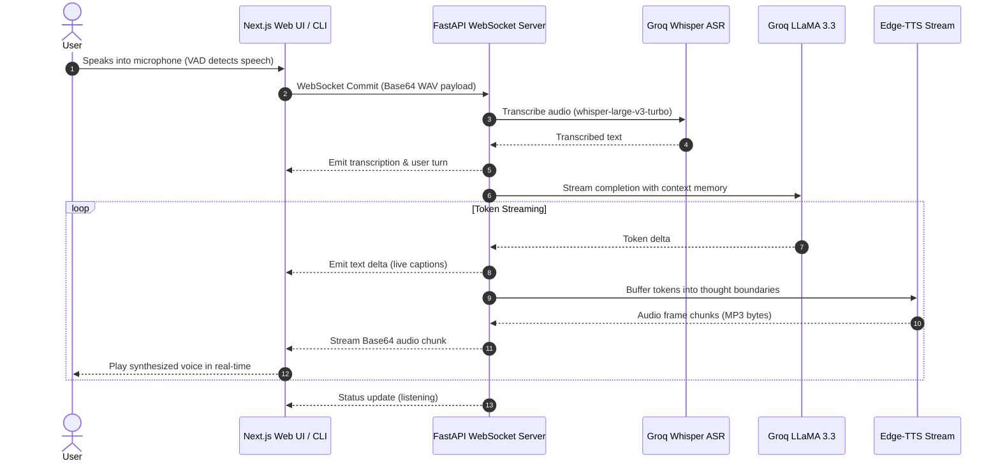

# VoiceDesk 🎙️⚡

> **High-Performance Real-Time Voice AI Agent**  
> Powered by Groq Cloud Whisper ASR, LLaMA 3.3 Intelligence, Microsoft Edge Neural TTS Streaming, and Next.js.

[](LICENSE)
[](https://fastapi.tiangolo.com/)
[](https://nextjs.org/)
[](https://groq.com/)

---

## 🌟 Highlights

- **⚡ Sub-Second Voice Turnaround**: Streaming tokens directly from Groq LLaMA 3.3 piped into Microsoft Edge-TTS audio frame generation.
- **🎯 Whisper-Large-v3-Turbo ASR**: High-accuracy, noise-tolerant speech recognition powered by Groq.
- **🌐 Full-Duplex WebSockets**: Real-time duplex voice streaming with silence/VAD auto-commit and text deltas.
- **🔮 Next.js Shadow Monarch Dashboard**: Ultra-modern reactive UI featuring live frequency visualizers, dynamic glow auras, and system telemetry streams.
- **💻 Dual Interaction Modes**: Full Next.js Web UI or standalone terminal CLI with speech and text fallback.
- **🧠 Contextual Conversation Memory**: Rolling conversational context with serialization and session resets.

---

## 🏗️ Architecture



---

## 📁 Repository Structure

```
VoiceDesk/
├── server.py              # FastAPI ASGI WebSocket and HTTP server
├── main.py                # Dual-mode Interactive CLI (Voice & Text)
├── asr.py                 # Groq Whisper speech transcription engine
├── llm.py                 # Groq LLaMA 3.3 streaming & sync chat engine
├── tts.py                 # File-based TTS engine with speed control
├── tts_stream.py          # Real-time streaming Edge-TTS pipeline
├── memory.py              # Rolling conversation window memory
├── prompts/
│   └── system_prompt.txt  # Tuned voice persona directives
├── utils/
│   └── audio.py           # Microphone recorder with PyAudio device checks
├── tests/                 # Automated Pytest suite
│   ├── test_memory.py
│   ├── test_llm.py
│   └── test_server.py
├── frontend/              # Next.js 16 Web Dashboard
│   ├── app/
│   │   ├── components/    # VoiceAgent, AudioVisualizer, Particles
│   │   ├── globals.css    # Tailwind CSS & glassmorphism theme
│   │   └── page.tsx       # Primary landing view
│   └── package.json
├── requirements.txt       # Python dependencies
├── .env.example           # Configuration template
└── README.md
```

---

## 🚀 Quickstart Guide

### 1. Prerequisites
- Python 3.10+
- Node.js 18+ and npm
- [Groq API Key](https://console.groq.com/keys) (Free tier available)
- Optional: `ffmpeg` for audio speed acceleration

### 2. Environment Setup

Clone and copy the environment template:
```bash
git clone https://github.com/harshh-0304/VoiceDesk.git
cd VoiceDesk
cp .env.example .env
```

Edit `.env` and insert your Groq API key:
```env
GROQ_API_KEY=gsk_your_groq_api_key_here
VOICEDESK_MODEL=llama-3.3-70b-versatile
VOICEDESK_VOICE=en-US-ChristopherNeural
PORT=8000
```

### 3. Install Python Dependencies
```bash
pip install -r requirements.txt
```

### 4. Run the Backend Server
```bash
python server.py
# Server runs on http://localhost:8000
```

### 5. Launch Next.js Dashboard
In a separate terminal:
```bash
cd frontend
npm install
npm run dev
# Visit http://localhost:3000
```

---

## 💻 Interactive Terminal CLI

Run VoiceDesk directly in your terminal:
```bash
python main.py
```
- **Voice Mode**: Speaks and listens through your system microphone and speakers.
- **Text Mode**: Type messages in the console with real-time spoken audio responses.
- Type `/clear` to wipe session memory or `q` to quit.

---

## 🧪 Testing

Run the automated test suite with pytest:
```bash
pytest tests/ -v
```

---

## 📡 API Endpoints & WebSocket Protocol

| Endpoint | Method | Description |
| :--- | :--- | :--- |
| `/` | `GET` | Root status probe |
| `/health` | `GET` | Service readiness & API key health check |
| `/api/info` | `GET` | Active model, voice, and audio specifications |
| `/ws/audio` | `WebSocket` | Real-time duplex audio communication stream |

### WebSocket Messages

- **Client to Server**:
  - `{"type": "commit", "audio_data": "<base64_wav>"}`: Send recorded user speech.
  - `{"type": "clear_memory"}`: Reset the active conversation history.
  - `{"type": "ping"}`: Heartbeat check.

- **Server to Client**:
  - `{"type": "transcription", "text": "...", "role": "user"}`: User speech transcribed.
  - `{"type": "text_delta", "delta": "..."}`: Streaming LLM response tokens.
  - `{"type": "audio_stream", "data": "<base64_mp3_chunk>"}`: Streaming audio frames.
  - `{"type": "status", "state": "listening" | "speaking" | "thinking"}`: State machine updates.

---

## 🏆 Author & License

Developed with ❤️ by **Harsh (Kiyo) Jadav** ([@harshh-0304](https://github.com/harshh-0304)).  
Licensed under the [MIT License](LICENSE).
